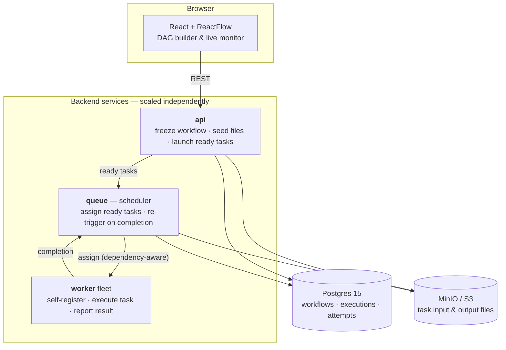

# TaskTide

Distributed workflow platform — design DAGs in a drag-and-drop UI and execute them across a containerized fleet of workers, with Postgres as the source of truth and S3-compatible storage for file payloads.

<!-- Record a 30-60s screencast and drop it in docs/ (see "Demo" below):

-->

## Features

- **Visual DAG builder** — drag-and-drop workflow editor (ReactFlow) with task palette, dependency edges, and live execution monitor
- **Distributed execution** — three services (API, queue/scheduler, worker) scaled independently; workers self-register and receive tasks over HTTP
- **Dependency-aware scheduling** — topological sort at launch plus unblocked-task queries; queue assigns ready tasks to free workers and re-triggers on every completion
- **File dataflow** — tasks pass data via files in MinIO/S3; chained outputs feed downstream inputs automatically
- **Durable state** — workflow/task executions and per-task attempts persisted in Postgres (sqlc + goose migrations)
- **Extensible task registry** — `NOOP`, `OUTPUT`, `csv.read`, `doc.read` executors included; new types plug into one switch
- **One-command deploy** — Docker Compose: Postgres → migrations → API/queue/worker → MinIO → nginx-served frontend

## Tech Stack

- **Backend:** Go 1.26, Chi, pgx, sqlc, goose, Postgres 15, MinIO (S3)
- **Frontend:** React 19, Vite, ReactFlow (@xyflow), Tailwind CSS 4
- **Infra:** Docker multi-stage builds + Compose, nginx

## Architecture



**How one run flows:**

1. **Launch** — the API creates a workflow execution and walks the dependency graph topologically, POSTing every task whose dependencies are satisfied to the queue.
2. **Schedule** — the queue asks Postgres for a free worker *and* an unblocked task. Dependency gating lives in a single SQL query (`GetUnassignedTasks`), so it stays race-free against the database.
3. **Execute** — the queue pulls the task's input file from MinIO and POSTs the task, with the file's contents, to the assigned worker.
4. **Report → repeat** — the worker executes and POSTs completion back; the queue re-runs the assignment loop, which unblocks the next layer of the DAG.

## Getting Started

### Prerequisites

- Docker + Docker Compose (full stack), or Go 1.26 + Node 18+ for local dev

### Run (full stack)

```bash
# 1. environment
cp .env.example .env          # adjust ports/credentials if you need to

# 2. build the frontend first -- nginx serves frontend/dist, so it must exist
cd frontend && npm install && npm run build && cd ..

# 3. bring the stack up
docker compose up --build
```

- App: `http://localhost:3000`
- API: `http://localhost:8080`
- MinIO console: `http://localhost:9001`

### Run (local dev)

```bash
# Backend (needs Postgres + MinIO running; copy required env vars into .env)
go mod download
go run ./cmd/api     # API service
go run ./cmd/queue   # scheduler service
go run ./cmd/worker  # worker (self-registers with the queue)

# Frontend
cd frontend && npm install && npm run dev
```

Required env: `POSTGRES_USERNAME`, `POSTGRES_PASSWORD`, `POSTGRES_DBSTRING`, `MINIO_USER`, `MINIO_PASSWORD`, `MINIO_HOST`, `MINIO_PORT`, `FILES_BUCKET_NAME`, `API_HOST/PORT`, `QUEUE_HOST/PORT`, `WORKER_HOST/PORT`.

### Try it

1. Open the UI, create a workflow, and drop tasks onto the canvas.
2. Upload an input file, chain tasks (`A → B → C → OUTPUT`), and start the run.
3. Watch per-task status update in the execution monitor.
4. Or run the scripted demo: `go run ./scripts/endToEnd.go`

## Demo

A 30–60 second screencast is the single most useful thing you can add here — nobody
will run `docker compose up` to evaluate this, but everyone will watch a GIF.

Suggested recording (screen capture with `wf-recorder`, `kooha`, or OBS):

1. Open `http://localhost:3000` with the canvas empty.
2. Drag three tasks onto the canvas and connect them `A → B → C`.
3. Upload an input file and hit **Run**.
4. Let the execution monitor tick each task to green.
5. Trim to ~30s, convert to GIF (`ffmpeg -i demo.mp4 -vf fps=12,scale=900:-1 docs/demo.gif`),
   commit it as `docs/demo.gif`, and uncomment the image at the top of this README.

## API Reference (selected)

**API service** — `POST /workflow/create`, `POST /workflow/add`, `POST /workflow/dependency`, `POST /workflow/` (start), `POST /workflow/status`, `GET /workflow/list`, `POST /file` (upload), `GET /file?id=`
**Queue service** — `POST /` (enqueue), `GET /` (poll/assign), `POST /worker` (register), `POST /worker/completion`
**Worker service** — `POST /task` (execute asynchronously)

## Project Structure

```
cmd/{api,queue,worker}/   # Service entrypoints
internal/
├── api/                  # HTTP routers per service
├── service/              # Business logic (startWorkflow, assign, execute)
├── repositories/         # Postgres + MinIO access layer
├── tasks/                # Task executors (noop, output, csv, doc)
├── models/               # Workflow/task domain types
└── db/                   # sqlc-generated queries
queries/                  # SQL sources for sqlc
migrations/               # goose migrations
frontend/src/             # ReactFlow builder + execution monitor
```
